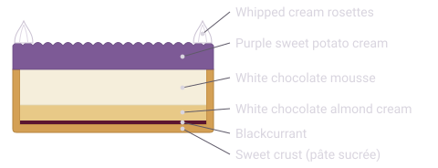
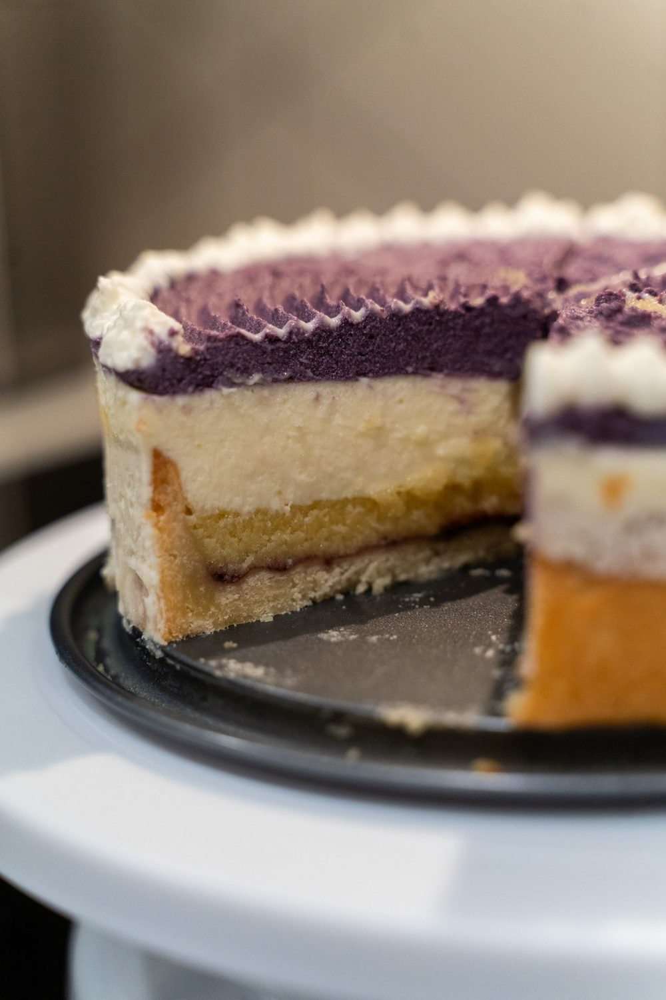
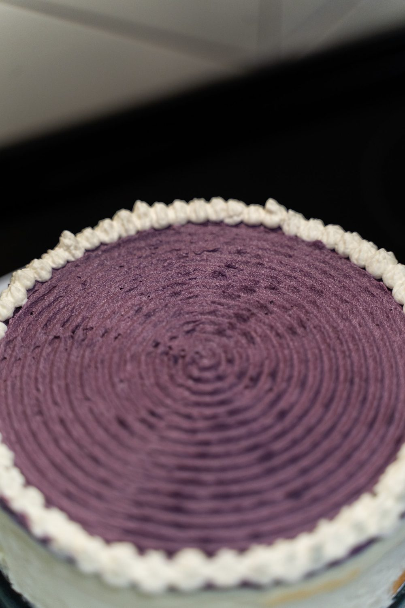
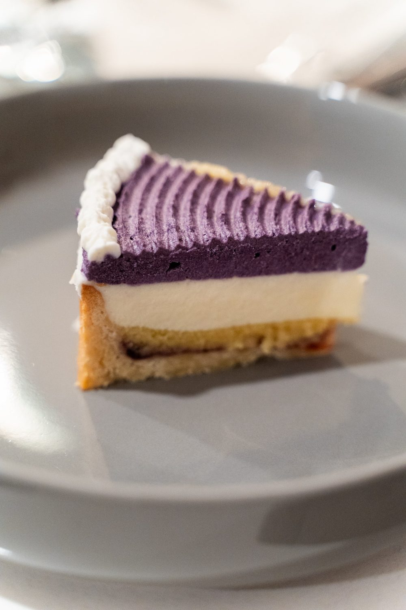

This tart takes its cue from the seasonal tarts of Japanese patisseries. It's built in five layers: a crisp, buttery sweet crust; a thin seam of sharp blackcurrant; white chocolate almond cream baked into the shell; a tall, airy white chocolate mousse; and a silky purple sweet potato cream, combed into fine rings and edged with small whipped cream rosettes. The violet color comes entirely from the sweet potato.

It's made over two days, and most of that time is hands-off: roasting, chilling and setting. The schedule shows how the pieces overlap, and every step lists exactly what it needs, so you can weigh as you go and work straight down the page.

## How the layers fit together

| Layer, top to bottom | What it brings |
|---|---|
| **Whipped cream rosettes** | A cool, lightly sweet border. |
| **Purple sweet potato cream** | Silky, earthy-sweet and naturally violet; the flavor that defines the tart. |
| **White chocolate mousse** | The tall, light middle, set with a little gelatin so it slices cleanly. |
| **White chocolate almond cream** | A moist, nutty layer baked into the shell. |
| **Blackcurrant** | A thin, sharp layer that cuts the richness. |
| **Sweet crust (pâte sucrée)** | Crisp and buttery, with walls tall enough to hold the mousse. |

*Cut through, each layer stays distinct once the tart is fully chilled.*

## Before you start

- **Read both days through once.** Each step lists its own ingredients, so you can weigh as you go.
- **Buy for the losses.** Roasting and sieving cost about half the sweet potato's weight, so 700 g raw yields the 300 g of purée you need. Only about half the blackcurrant conserve passes the strainer, so 100 g gives the 50 g you spread.
- **Weigh in grams.** The US measures are approximate. A scale that reads in 1 g steps is enough; 0.1 g makes the gelatin easier. Pour liquids slowly, since most scales lag a moment and overshoot.
- **Keep white chocolate dry.** Every bowl, spoon and spatula that touches it must be completely dry; a drop of water makes it seize.
- **Soften ahead.** When you start Day 1, set out 50 g butter and 1 egg for the almond cream. On Day 2, set out 30 g butter 30 minutes before you begin.
- **Cut the parchment.** You need a 30 cm (12 in) square of plain parchment for blind baking. Pre-cut round liners rarely fit a 7-inch pan.
- **Make room.** Clear a level shelf in the fridge with enough height for the pan.
- **Ready the finishing kit for Day 2:** turntable, fine-tooth comb, offset spatula, star tip, piping bag and a tall glass.

## Ingredient notes

**Purple sweet potatoes.** Use sweet potatoes that are purple all the way through: Stokes Purple (purple skin, purple flesh) or Okinawan (pale tan skin, purple flesh). Japanese sweet potatoes, often labeled Murasaki, have purple skin but white flesh and won't give the color. Choose firm potatoes of a similar size so they roast evenly.

**White chocolate.** Use bars, not chips, and check that cocoa butter is the fat on the label. Chips, “white baking” products and candy melts often use other fats and won't melt smoothly or set the same way. You need 220 g in all; three standard bars cover it.

**Blackcurrant conserve.** Sold as blackcurrant conserve, jam or preserves, usually among imported British and European jams. One widely available option is [Tiptree Black Currant Preserve](https://www.amazon.com/dp/B00DYQ3Z5E?tag=purpletart-20). Red currant jelly is a different fruit, and dried currants are tiny raisins; neither works here. If you can't find blackcurrant, see [Variations](#variations).

**Gelatin.** Unflavored powdered gelatin. 3 g is about 1 level teaspoon; a standard ¼-oz envelope holds about 7 g, so you'll use a little less than half.

**Heavy cream.** Heavy cream or heavy whipping cream with at least 36% fat; lighter whipping cream won't hold firm rosettes. Shake the carton before measuring, since the fat rises to the top.

**Almond flour.** Blanched and finely ground, not coarse almond meal.

**Butter and eggs.** Unsalted butter, and large eggs (about 50 g each out of the shell).

## Equipment

| Item | Notes |
|---|---|
| **7-inch (18 cm) springform pan** | 2½–3 in (6–7.5 cm) deep. The ring supports the layers while they set, then lifts away. |
| **Digital scale** | Reads in 1 g steps; 0.1 g is useful for the gelatin. |
| **Hand mixer** | The amounts here are too small for most stand mixer bowls. |
| **Small, deep bowl and a deep, narrow container** | About 1½ qt (1.4 L). Small quantities need depth so the beaters stay in them. |
| **Fine-mesh strainers, large and small** | Large for the sweet potato, small for the conserve. |
| **Rolling pin and a ruler** | For a 3 mm (⅛ in) sheet and 4 cm (1½ in) walls. |
| **Pie weights** | About 2 cups. Dried beans or rice work too. |
| **Parchment paper** | A roll: you'll cut a 30 cm (12 in) square, plus a strip for a collar if needed. |
| **Small saucepan** | For heating the cream (or use the microwave). |
| **Cooling rack** |  |
| **Flexible spatula and a plastic scraper** |  |
| **Cake turntable** | For spreading and combing the top. |
| **Offset spatula** | Small or medium. |
| **Fine-tooth cake comb** | Also sold as a decorating or icing comb. Fine, even teeth give the ringed finish. |
| **Small open star piping tip** | About 6–7 mm (¼ in) across, such as a #21, plus disposable piping bags. |
| **Long, thin knife** | For clean slices. |
| **Microwave** | For melting chocolate and warming the purée. A double boiler works too; keep every drop of water away from the chocolate. |

Helpful but optional: **Potato ricer or drum sieve** (speeds up sieving); **Instant-read thermometer** (for the mousse base, 85°F (29°C)).

### The tools used for this tart

*Affiliate links. As an Amazon Associate I earn from qualifying purchases.*

- [Nordic Ware Springform Pan, 7 inch](https://www.amazon.com/dp/B000237FS0?tag=purpletart-20): The pan used here; its deep ring holds the layers while they set.
- [Mrs. Anderson's Ceramic Pie Weights](https://www.amazon.com/dp/B00004S1BT?tag=purpletart-20): Ceramic beads for blind baking.
- [AISOSO French Rolling Pin](https://www.amazon.com/dp/B08RCKDZZN?tag=purpletart-20): A wooden French-style pin for rolling the crust.
- [Cuisinart 3-Piece Mesh Strainer Set](https://www.amazon.com/dp/B007TUQF9O?tag=purpletart-20): The large strainer for the sweet potato, the small one for the conserve.
- [Dash Cordless Hand Mixer](https://www.amazon.com/dp/B0H2FZYRL4?tag=purpletart-20): For creaming and whipping the small amounts here.
- [Hario Drip Scale](https://www.amazon.com/dp/B009GPJMOU?tag=purpletart-20): Handles the small weights here, like the 3 g of gelatin.
- [Kootek Cake Decorating Kit](https://www.amazon.com/dp/B07M7M898T?tag=purpletart-20): Turntable, spatulas, piping tips and bags in one kit.
- [Victorinox Fibrox Pro 8-inch Chef's Knife](https://www.amazon.com/dp/B008M5U1C2?tag=purpletart-20): For clean slices.

## Schedule

Times are from when you start each day. The overlaps are what keep Day 1 under five hours.

### Day 1

*About 4¾ hours, plus at least 4 hours setting*

| Time | What happens |
|---|---|
| 0:00 | Heat the oven to 375°F (190°C) and wrap the potatoes. Set out 50 g butter and 1 egg. |
| 0:15 | Potatoes in, 60–75 minutes. Make the crust dough; chill 1 hour. |
| 1:20 | Potatoes out. Lower the oven to 350°F (175°C). |
| 1:30 | Roll and line the pan; freeze 20 minutes. Start sieving the potatoes while they're warm. |
| 2:05 | Level the crust edge and blind bake: 20 minutes with weights, 8–10 without. Meanwhile, strain the conserve, make the almond cream and finish sieving. |
| 2:40 | Cool the shell 10 minutes. Lower the oven to 340°F (170°C). Refrigerate the purée. |
| 2:50 | Add the conserve and almond cream; bake 22–25 minutes. |
| 3:15 | Cool 1 hour. |
| 4:15 | Make the mousse and pour it in. Into the fridge by about 4:40 to set for at least 4 hours, ideally overnight. |

### Day 2

*About 2¼ hours, including 1 hour chilling*

| Time | What happens |
|---|---|
| 0:00 | Set out 30 g butter. Check the mousse is set. |
| 0:30 | Make the potato cream. |
| 0:45 | Spread and comb; chill 15 minutes. Meanwhile, whip the topping and fill the piping bag. |
| 1:00 | Unmold. |
| 1:05 | Pipe the rosettes; chill 1 hour. |
| 2:15 | Slice and serve. |

## Shopping list

Totals for the whole tart. Each step in the method lists its own amounts.

- 700 g (1½ lb) purple sweet potatoes
- 220 g (7¾ oz) white chocolate, in bars
- About 400 g (1¾ cups) heavy cream; one pint covers it
- 155 g (11 tbsp) unsalted butter, plus a little for the pan
- 2 large eggs
- 65 g (⅔ cup) almond flour
- 125 g (1 cup) all-purpose flour, plus a little for rolling
- About 95 g (scant ½ cup) granulated sugar
- 45 g (⅓ cup + 1 tbsp) powdered sugar
- 100 g (scant ⅓ cup) blackcurrant conserve
- 3 g (1 tsp) powdered gelatin
- ¼–½ tsp vanilla extract
- 2 pinches fine salt

The tools used for this tart are listed under [Equipment](#equipment).

## Method

### Day 1

*About 4¾ hours, plus at least 4 hours setting*

#### 1. Roast the sweet potatoes

*60–75 min, mostly hands-off*

Start here. Everything else on Day 1 fits around the roasting.

| Ingredient | Metric | US |
|---|---|---|
| Purple sweet potatoes | 700 g | 1½ lb |

**You’ll need:** Foil, a fork, a thin knife

1. Heat the oven to **375°F (190°C)** with a rack in the middle.
2. Scrub the potatoes and prick each one 5 or 6 times with a fork. Wrap them in foil and crimp the seams tightly so the steam stays in.
3. Roast **60–75 minutes**, until a thin knife slides into the thickest part of the largest potato with no resistance at all. Underdone potato won't go through the sieve, so when in doubt, give it longer.
4. Open the foil on a plate to let the steam escape; purple juice in the foil is normal. Sieve them while they're still warm ([step 5](#step-5)): cold potato is much harder to push through.
5. Lower the oven to **350°F (175°C)** for the crust.

#### 2. Make the sweet crust dough

*15 min, plus 1 hour chilling*

| Ingredient | Metric | US |
|---|---|---|
| All-purpose flour | 125 g | 1 cup |
| Powdered sugar | 45 g | ⅓ cup + 1 tbsp |
| Almond flour | 15 g | 2½ tbsp |
| Fine salt | a pinch |  |
| Cold unsalted butter, in 1 cm (½ in) cubes | 75 g | 5 tbsp + 1 tsp |
| Beaten egg | 25 g | about ½ large egg |

1. Whisk the flour, powdered sugar, almond flour and salt in a medium bowl.
2. Add the butter and rub it in with your fingertips: press each cube flat, toss it through the flour and keep going until the mixture looks like damp sand, with no butter pieces bigger than a pea, **3–4 minutes**. Work quickly so the butter stays cold.
3. Beat 1 egg in a cup and pour **25 g** of it over the mixture. Keep the rest for another use.
4. Stir with a fork until shaggy, then squeeze and press the dough together with your hands until it holds in one piece. Don't knead; overworked dough bakes up tough and shrinks.
5. Flatten it into a disc about 2 cm (¾ in) thick. Seal it in a zip-top bag with the air pressed out, or wrap it tightly, and refrigerate **1 hour**.

#### 3. Line the pan

*15 min, plus 20 min freezing*

**You’ll need:** 7-inch springform, soft butter for the pan, flour for dusting, rolling pin, ruler, fork, plastic scraper

1. Butter the base and sides of the locked springform with a thin film. (To move the finished tart off the metal base later, first clamp a square of parchment between the base and the ring and trim the overhang.)
2. Cut the bag open and peel it away from the dough rather than pulling the dough out. Let it sit **5–10 minutes**, until a fingertip dents it without the edge cracking; straight from the fridge, it tears.
3. On a lightly floured counter, roll it into a **28 cm (11 in)** circle about **3 mm (⅛ in)** thick. Give it a quarter turn every few strokes and dust underneath as needed so it never sticks.
4. Roll the dough loosely around the pin and unroll it over the pan. Ease it into the bottom corner by lifting the edge and letting it drop, rather than stretching it down. If it tears, press the pieces into place by hand; this dough mends without a trace.
5. Press the dough up the sides and **measure: the walls need to reach 4 cm (1½ in) all the way around.** Build up any low spots with scraps and press them smooth; don't trim down to the lowest point. Wrap a pea-sized piece of scrap and refrigerate it for patching later.
6. Prick the base about 15 times with a fork, right through to the pan. Freeze **20 minutes**.
7. Level the top edge of the frozen walls with a plastic scraper or your fingers. Keep knives away from a nonstick pan.

#### 4. Blind bake the crust

*About 30 min*

**You’ll need:** 30 cm (12 in) square of parchment, about 2 cups pie weights, foil, cooling rack

1. Crumple the parchment into a tight ball, open it out and press it into the frozen shell, right into the corner. Fill it to the top with weights and push them out against the walls; they hold the walls up as well as the base down.
2. Set the pan directly on the middle rack, with a sheet of foil on the rack below to catch any drips. Bake at **350°F (175°C) for 20 minutes**.
3. Lift out the weights by gathering the corners of the parchment into a pouch and lifting straight up. They're very hot; tip them into a heatproof bowl.
4. Bake **8–10 minutes** more, until the base looks dry and the edges are pale gold. If the base puffs, press it down gently with the back of a spoon. Press a little of the reserved scrap dough into any cracks.
5. Cool on a rack **10 minutes**. Lower the oven to **340°F (170°C)**.

#### 5. Sieve the sweet potatoes

*About 25 min, during the freeze and blind bake*

**You’ll need:** Your largest fine-mesh strainer, a bowl, a rounded scraper or spoon, plastic wrap

1. Halve the potatoes and peel or scoop away the skin. Discard any stringy or dark bits near the ends.
2. Set the strainer over a bowl. Working a few spoonfuls at a time, rub the potato across the mesh **sideways** with your fingertips or a rounded scraper. Pressing straight down clogs the mesh and strains it; sideways strokes push the potato through.
3. Scrape the underside of the strainer often; a lot of purée clings there. If the potato cools and stiffens, microwave it **20 seconds**.
4. Weigh the purée. You need **300 g**; it will look slightly clumpy, which is correct. Press plastic wrap onto the surface and refrigerate until Day 2.

> **Tip:** A potato ricer for the first pass, or a drum sieve with a bench scraper, makes this much quicker. If you end up short of 300 g, scale the potato cream to match ([step 8](#step-8)).

#### 6. Add the blackcurrant and almond cream, and bake

*20 min, plus 25 min baking and 1 hour cooling*

| Ingredient | Metric | US |
|---|---|---|
| Blackcurrant conserve | 100 g | scant ⅓ cup |
| White chocolate, chopped | 40 g | 1.4 oz |
| Soft unsalted butter | 50 g | 3½ tbsp |
| Granulated sugar | 40 g | 3 tbsp + 1 tsp |
| Large egg, at room temperature | 1 |  |
| Almond flour | 50 g | ½ cup |

**You’ll need:** Small fine strainer, small deep bowl, hand mixer, offset spatula, toothpick

1. Warm the conserve in the microwave **10–15 seconds**, then rub it through a small fine strainer into a clean cup with the back of a spoon to remove the seeds and skins. Expect about 50 g, roughly half.
2. Melt the white chocolate in a dry bowl in **15-second bursts**, stirring after each, usually 3–4 rounds. Stop while a few small lumps remain and stir until they melt; white chocolate scorches quickly.
3. In a small, deep bowl, beat the butter and sugar with a hand mixer on low, then medium, for **1 minute**, until pale and creamy.
4. Beat in the egg (the mixture will look curdled; that's fine), then the almond flour, then the melted chocolate, until smooth.
5. Spread the strained conserve over the base of the shell in a thin, even layer, keeping it off the walls.
6. Drop the almond cream over it in small spoonfuls so you don't drag the conserve, then level it gently with the back of the spoon or an offset spatula. Wipe the top edge of the crust clean.
7. Bake at **340°F (170°C) for 22–25 minutes**, until the edges are golden, the surface has lost its shine and a toothpick in the center comes out clean.
8. Cool in the pan on a rack for **1 hour**. The base must be completely cool before the mousse goes on.

#### 7. Make the white chocolate mousse

*25 min, plus at least 4 hours setting*

| Ingredient | Metric | US |
|---|---|---|
| White chocolate, finely chopped | 150 g | 5.3 oz |
| Cold water | 15 g | 1 tbsp |
| Powdered gelatin | 3 g | 1 tsp |
| Heavy cream, to heat | 80 g | ⅓ cup |
| Cold heavy cream, to whip | 150 g | ⅔ cup |

**You’ll need:** Small saucepan, medium heatproof bowl, hand mixer, deep container for whipping, spatula, thermometer (helpful), parchment strip (if needed), foil

1. Check the crust walls. If any part is lower than 4 cm (1½ in), slide a strip of parchment down between the ring and the crust so it stands above the crust edge; the mousse will set against it.
2. Sprinkle the gelatin over the cold water in a small cup and leave **5 minutes** to bloom. It turns solid and spongy.
3. Put the chopped chocolate in a medium heatproof bowl.
4. Heat the 80 g of cream in a small saucepan, or in the microwave in short bursts, until it's steaming with small bubbles at the edge, **2–3 minutes**. Don't let it boil.
5. Off the heat, add the bloomed gelatin and stir until it has dissolved completely, with no visible granules.
6. Pour the hot cream over the chocolate, wait **1 minute**, then stir from the center outward until smooth and glossy. If a few lumps remain, microwave **10 seconds** and stir again.
7. Let it cool, stirring now and then, until barely warm to the touch, about **85°F (29°C)**, 10–15 minutes. Too hot and it melts the whipped cream; too cool and it starts to set and turns lumpy when folded.
8. Meanwhile, shake the cream carton, then whip the 150 g of cold cream to **soft peaks**: it holds a trail, and the peak flops over when you lift the beaters (about **3–4 minutes** with a hand mixer). Stop there; over-whipped cream makes a grainy, heavy mousse.
9. Stir a third of the whipped cream into the chocolate to loosen it, then fold in the rest with a spatula until no streaks remain.
10. Pour onto the cooled almond cream, level it and tap the pan twice on the counter to release bubbles.
11. Tent loosely with foil, keeping it off the surface, and refrigerate at least **4 hours**, ideally overnight.

### Day 2

*About 2¼ hours, including 1 hour chilling*

*The finish to aim for: fine concentric rings and a border of small, touching rosettes.*

#### 8. Make the purple sweet potato cream

*15 min (set the butter out 30 min ahead)*

| Ingredient | Metric | US |
|---|---|---|
| Sieved purple sweet potato, from step 5 | 300 g | about 1¼ cups |
| Soft unsalted butter | 30 g | 2 tbsp |
| Granulated sugar | 45 g | 3½ tbsp |
| Fine salt | a pinch |  |
| White chocolate, chopped | 30 g | 1 oz |
| Cold heavy cream | 60–80 g | 4–5 tbsp |
| Vanilla extract (optional) | ¼ tsp |  |

**You’ll need:** Hand mixer, medium bowl, a spoon for tasting

1. Check that the mousse is set: it shouldn't ripple when you tilt the pan.
2. Warm the purée in the microwave **20–30 seconds**, just to take the chill off.
3. Beat the purée, butter, sugar and salt until smooth, with no lumps of butter.
4. Melt the white chocolate (15-second bursts, as before) and beat it in now, while the purée is still warm and before any cream goes in, so it blends in smoothly instead of setting into flecks.
5. Beat in the cream **a tablespoon at a time** until the mixture is smooth and spreadable and a groove drawn with a spoon holds its shape. That's usually 4–5 tablespoons, but purées vary, so go by texture.
6. Taste. It should taste like dessert, not a side dish. If it reads as potato, add sugar a teaspoon at a time, and the vanilla.
7. Short on purée? Scale every ingredient in this step by the same factor: for 240 g of purée, use 0.8 × each amount.

#### 9. Spread and comb the top

*15 min, plus 15 min chilling*

**You’ll need:** Cake turntable, damp paper towel, offset spatula, fine-tooth cake comb

1. Lay a damp paper towel on the turntable and set the tart, still in its ring, on top so it can't slide.
2. Spoon all of the potato cream onto the center. Spread it out to the ring with the front edge of the offset spatula in short strokes, turning the turntable as you go, until the layer is even.
3. Rest the fine teeth of the comb on the surface at the outer edge. Hold your hand still and turn the turntable one full circle. Move the comb inward by the width of its toothed edge and repeat, ring by ring, to the center. (For a continuous spiral, draw the comb slowly inward as you turn.)
4. If a ring wobbles, smooth the surface flat and comb again; the cream is forgiving.
5. Chill **15 minutes** to firm the surface.

#### 10. Whip the topping and fill the bag

*10 min, during the 15-minute chill*

| Ingredient | Metric | US |
|---|---|---|
| Cold heavy cream | 100 g | 7 tbsp |
| Granulated sugar | 8 g | 2 tsp |
| Vanilla extract | ¼ tsp |  |

**You’ll need:** Small open star tip (#21 size), disposable piping bag, tall glass, deep narrow container, hand mixer

1. Drop the tip into the bag and snip the end so about a third of the tip pokes through, with the teeth fully clear of the bag. Twist the bag just above the tip so nothing leaks while you fill it, and stand it in a tall glass with the top folded over the rim.
2. In a deep, narrow container, whip the cream, sugar and vanilla to **firm peaks**, about **3–4 minutes**: the peak stands straight up and the cream looks matte. Stop there; past firm peaks it turns grainy and pipes with ragged edges. If it won't thicken, chill the container and beaters in the freezer for 5 minutes and try again.
3. Fill the bag no more than two-thirds full. Untwist it above the tip, push the cream down toward the tip and twist the top closed. Keep it standing in the glass in the fridge until you pipe.

#### 11. Unmold

*5 min*

**You’ll need:** Kitchen towel, hot water, thin knife or small offset spatula

1. Soak a kitchen towel in hot tap water, wring it out and wrap it around the outside of the ring for **30 seconds**.
2. Run a thin knife or small offset spatula around the inside of the ring, pressed against the metal. **Do this before you open the latch**; otherwise the ring tears the sides as it springs open.
3. Open the latch slowly, lift the ring straight up and peel away any parchment collar.
4. Smooth any rough patches on the sides with a warm, dry spatula (dip it in hot water and wipe it dry).

#### 12. Pipe, chill and slice

*10 min, plus 1 hour chilling*

**You’ll need:** The filled piping bag, a plate for practice, a long thin knife, hot water, a cake server

1. Practice two rosettes on a plate: hold the bag straight up with the tip about 1 cm (⅜ in) above the surface, squeeze until the cream spreads into a rosette, stop squeezing, then lift straight up.
2. Pipe touching rosettes all the way around the edge of the tart, about 60 in all.
3. Chill uncovered for **1 hour** so everything firms up.
4. To slice, dip a long, thin knife in hot water and wipe it dry. Press straight down through all the layers in one push, then draw the knife out toward you along the base rather than lifting it back through the top. Clean and reheat the knife between cuts.
5. Lift the slices out with a cake server slid under the crust. Serve cold.

*A clean slice: chilled for an hour and cut with a hot, dry knife.*

## Troubleshooting

| Problem | What to do |
|---|---|
| **Sieving is slow, or the mesh feels like it might tear** | Work a few spoonfuls at a time and rub sideways instead of pressing down. Keep the potato warm (20 seconds in the microwave), scrape the underside often, and make sure the potatoes were roasted until completely soft. A ricer for the first pass, or a drum sieve, is faster. |
| **Not enough purée** | Start with 700 g raw and scrape the underside of the sieve well. If you're still short, scale the potato cream to the purée you have (step 8). |
| **The conserve strains slowly** | Warm it 10–15 seconds first and press it through a small strainer with the back of a spoon. About half comes through, which is enough for a thin layer. |
| **The dough cracks or tears while rolling** | It's too cold. Let it sit until a fingertip dents it without cracking. Tears can be pressed together in the pan; this dough mends seamlessly. |
| **The crust walls came out low** | Measure 4 cm (1½ in) before freezing and build up low spots instead of trimming. If they're still short after baking, add a parchment collar before the mousse (step 7). |
| **The butter and sugar won't cream** | The bowl is too wide for the amount. Use a small, deep bowl so the beaters stay in the mixture. |
| **The white chocolate went thick and grainy** | It overheated or met water. Melt it in short bursts, stop while a few lumps remain, and keep everything dry. Start that batch again rather than using it. |
| **The mousse has lumps or rubbery strings** | The gelatin wasn't fully dissolved, or the base was too cool when the cream went in. Dissolve the gelatin completely in the hot cream, and fold when the base is barely warm, about 85°F (29°C). |
| **The mousse didn't set** | Give it at least 4 hours. Under-whipped cream, or a base hot enough to melt the whipped cream, also leaves it soft. |
| **The potato cream is too stiff, or too soft** | Too stiff: beat in more cream a tablespoon at a time. Too soft: chill it 10 minutes. |
| **The potato cream tastes like potato** | It needs its sugar and white chocolate. Add sugar a teaspoon at a time, a little vanilla and a pinch of salt until it tastes like dessert. |
| **The comb lines look uneven** | Smooth the surface flat and comb again. Keep the comb still and let the turntable do the moving. |
| **The sides tore when the ring came off** | Warm the ring with a hot towel and run a thin knife around the inside before opening the latch. Smooth the sides afterward with a warm, dry spatula. |
| **The rosettes slump or look ragged** | Whip to firm peaks in a cold, deep container, but no further, or the cream turns grainy. Keep the filled bag in the fridge until you pipe. |
| **The slices smear** | Chill fully, then use a long knife dipped in hot water and wiped dry. Push straight down once, draw it out along the base, and clean the knife between cuts. |
| **Day 1 is running long** | Get the potatoes in first, and sieve during the freeze and blind bake. Everything after the mousse waits for Day 2. |

## Variations

### A shorter tart

For a lower profile, make two-thirds of the mousse: 100 g white chocolate, 2 g gelatin bloomed in 2 tsp water, 55 g hot cream and 100 g cream whipped to soft peaks. The method is the same, and the finished tart stands about 7 mm (¼ in) lower.

### More sweet potato

Leave the white chocolate out of the potato cream for a more pronounced sweet potato flavor, then add sugar a teaspoon at a time until it tastes like dessert.

### Without blackcurrant

Spread 50 g of a sharp, seedless jam, such as seedless raspberry, and skip the straining. The tartness is part of the balance, so choose the sharpest jam you can find.

### A 9-inch tart

Multiply every quantity by 1.65 and expect longer bakes; go by the visual cues rather than the clock. This size hasn't been tested.

## Storage, make-ahead and transport

### Storing

Keep the tart in the fridge under an upturned bowl or a cake dome (plastic wrap would mark the top) for up to 3 days. The crust softens a little each day. Serve it cold.

### Making ahead

The dough keeps 2 days in the fridge, well wrapped. The sieved purée keeps 2 days in the fridge or 3 months in the freezer; thaw it overnight in the fridge. Day 1 is make-ahead by design: the mousse sets overnight.

### Leftovers

Bake dough scraps at 350°F (175°C) for 10–12 minutes for a cook's treat. Extra purée freezes.

### Transporting

An 8 × 8 × 5-inch bakery box with an 8-inch cake board fits the tart. Leave it on the springform base, or slide it off on its parchment if you used one ([step 3](#step-3)). In a cooler, set ice packs around the sides of the box rather than on top, and keep it level.

## FAQ

### Can I use ube or orange sweet potatoes?

Not as a direct swap. Ube is a different root, with more moisture and a different flavor. Orange sweet potatoes give an orange top and a softer, sweeter cream; add the cream gradually and expect to need less.

### Do I have to sieve the sweet potatoes?

Yes. Sieving is what makes the top silky enough to comb; mashed potato stays fibrous and drags under the comb, and blending turns it gummy.

### Why does my potato cream taste like potato?

The sugar and white chocolate are what turn it into a dessert. Taste before you spread it and adjust ([step 8](#step-8)).

### Can I skip the gelatin, or use agar?

Don't skip it: the gelatin is what lets the mousse stand tall and slice cleanly. Agar sets firmer and at a higher temperature, and hasn't been tested here.

### Why a springform instead of a tart pan?

The tart stands taller than a fluted tart pan allows. The springform's deep ring holds the layers while they set, then lifts away cleanly.

### Can I make it in one day?

Yes, if you start early. The mousse needs at least 4 hours before the potato cream goes on, so it's about 11 hours start to finish.
